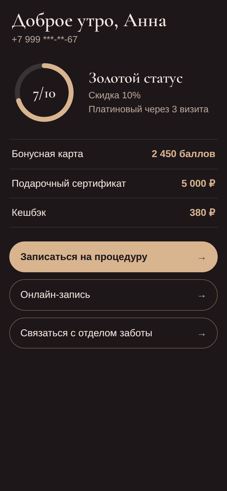
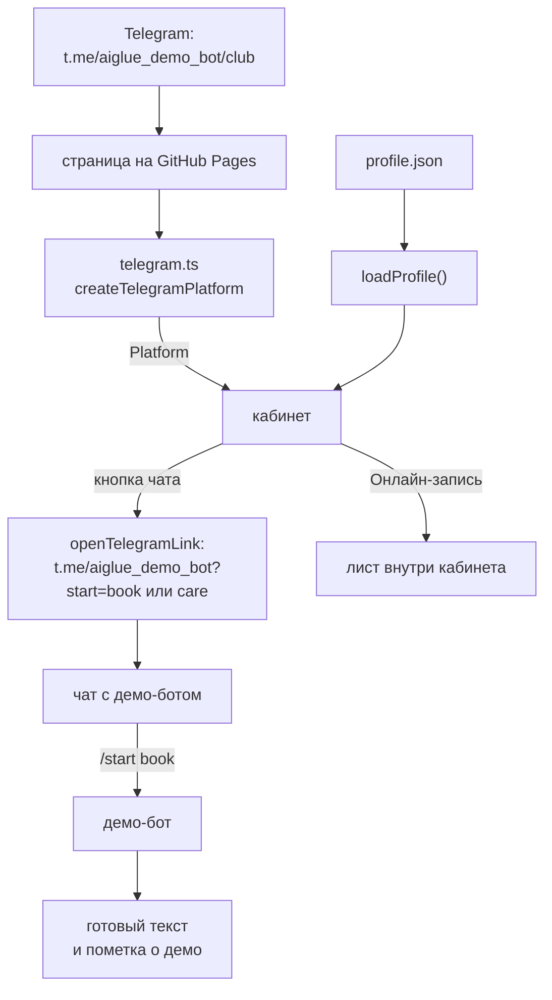

# Демо: кабинет клиента клуба в Telegram Mini App

Это демонстрация, а не готовый продукт: данные клуба тестовые, кнопки
«Записаться на процедуру» и «Связаться с отделом заботы» ведут в чат демо-бота,
а не к менеджеру. Клуб красоты и клиентка вымышлены, ответ API заменён
JSON-файлом в этом же репозитории, чтобы кабинет можно было открыть и проверить
без боевых доступов.

[](https://github.com/dkyitdevops/tg-miniapp-club-demo/actions/workflows/web.yml)
[](https://github.com/dkyitdevops/tg-miniapp-club-demo/actions/workflows/bot.yml)



В кабинете сверху вниз: приветствие по имени и времени суток, номер телефона
под маской, статус клуба со скидкой и кольцом визитов до следующего статуса,
три бонусные карты с балансом и три кнопки: «Записаться на процедуру»,
«Онлайн-запись», «Связаться с отделом заботы». Кабинет написан на React,
TypeScript и Vite (`web/`), демо-бот на Python 3.12 и aiogram 3 (`bot/`).

## Открыть

- В Telegram: https://t.me/aiglue_demo_bot/club
- В браузере: https://dkyitdevops.github.io/tg-miniapp-club-demo/

В браузере кабинет тот же, но имени из Telegram и хаптики нет: приветствие
обращается к тестовой клиентке Анне, а кнопки чата открывают ссылку t.me на
демо-бота в новой вкладке. Тема у кабинета одна, тёмная: светлую тему Telegram
он не подхватывает.

## Как устроено



Telegram открывает страницу кабинета с GitHub Pages. `main.tsx` создаёт адаптер
Telegram, а дальше кабинет работает только через интерфейс `Platform`. Профиль
клиента он берёт из `loadProfile()`, которая сейчас читает `profile.json`.
Кнопки «Записаться на процедуру» и «Связаться с отделом заботы» открывают чат с
демо-ботом по ссылке с меткой: `https://t.me/aiglue_demo_bot?start=book` или
`?start=care`. Демо-бот получает метку командой `/start book` и отвечает готовым
текстом сообщения менеджеру, пометкой о демо и кнопкой «Открыть кабинет». Кнопка
«Онлайн-запись» чат не открывает, она показывает лист внутри кабинета.

Кабинет (`web/`):

- `web/index.html`: фон страницы задан до загрузки скриптов (тот же цвет стоит в
  `theme-color`), оба файла шрифта заголовков предзагружаются, затем
  подключается `telegram-web-app.js` от Telegram.
- `web/src/main.tsx`: берёт цвет фона из токена `--color-bg`, создаёт адаптер
  через `createTelegramPlatform` и отдаёт его компоненту `App`.
- `web/src/platform.ts`: интерфейс `Platform` (`viewer`, `ready`, `openChat`,
  `tap`) и тип `ChatTopic` с метками `book` и `care`.
- `web/src/telegram.ts`: `createTelegramPlatform`, единственное место, где
  читается `window.Telegram`. Красит шапку, фон и нижнюю панель Telegram в цвет
  кабинета с проверкой версии клиента, разворачивает кабинет, берёт имя из
  `initDataUnsafe`, открывает чат через `openTelegramLink` и даёт лёгкую
  хаптику. Вне Telegram (скрипт не загрузился или `WebApp.platform` равен
  `unknown`) возвращает вариант для браузера: имени и хаптики нет, чат
  открывается в новой вкладке.
- `web/src/config.ts`: `BOT_USERNAME`, имя демо-бота для ссылок на чат.
- `web/src/App.tsx` и `web/src/components/`: сам кабинет. `StatusCard.tsx`
  рисует статус и кольцо визитов, `BonusCards.tsx` список бонусных карт (они не
  нажимаются), `Actions.tsx` три кнопки, `BookingSheet.tsx` лист
  «Онлайн-запись».
- `web/src/data/profile.ts`: `loadProfile()`, единственное место, которое знает,
  откуда берутся данные. Сейчас отдаёт содержимое `profile.json` промисом, как
  настоящий запрос.
- `web/src/data/profile.json`: тестовый ответ API с клиенткой, её статусом и
  тремя бонусными картами. Ссылки на отзывы по филиалам в ответе тоже есть, но
  кабинет их не показывает.
- `web/src/data/types.ts`: типы ответа API (`ProfileResponse` и вложенные).
  Поля в snake_case, как в JSON.
- `web/src/format.ts`: приветствие по часу, маска телефона, склонение слов
  «балл» и «визит», неразрывные пробелы в числах.
- `web/src/styles/tokens.css`: токены (цвета, шрифты, скругления) и подключение
  шрифта Cormorant Garamond.
- `web/src/styles/app.css`: стили компонентов, цвета и шрифты берутся только из
  токенов.
- `web/src/styles/styles.test.ts`: три проверки. В `app.css` нет цветов hex и
  rgb и шрифтов мимо токенов, фон первой отрисовки и `theme-color` в `index.html`
  совпадают с `--color-bg`, каждый шрифт из `tokens.css` предзагружается в
  `index.html`.

Демо-бот (`bot/`):

- `bot/main.py`: запускает демо-бота. Читает настройки, выставляет описание
  демо-бота и краткое описание его профиля, начинает long polling.
- `bot/config.py`: `load_settings` берёт `BOT_TOKEN` и `WEBAPP_URL` из
  окружения. Если одной из них нет, демо-бот останавливается и называет её.
- `bot/handlers.py`: `build_router()`. На `/start` демо-бот отвечает по метке,
  на любое другое сообщение в личном чате говорит, что понимает только
  сообщения из кабинета. Под обоими ответами кнопка «Открыть кабинет». В группах
  демо-бот молчит, на служебное `write_access_allowed` не отвечает.
- `bot/replies.py`: тексты и клавиатура. `TOPICS` (готовый текст для меток
  `book` и `care`), `DEMO_NOTE` (пометка о демо), `DESCRIPTION` и
  `SHORT_DESCRIPTION` (описание демо-бота), `start_reply`, `fallback_reply`,
  `open_app_keyboard` (кнопка «Открыть кабинет»).
- `bot/.env.example`: `BOT_TOKEN` и `WEBAPP_URL`. Настоящий `.env` в git не
  попадает.
- `bot/Dockerfile` и `bot/docker-compose.yml`: образ на `python:3.12-slim`,
  процесс под пользователем `nobody`, перезапуск `unless-stopped`.

CI (`.github/workflows/`):

- `web.yml`: lint, тесты, сборка и `npm audit` для кабинета, а при пуше в
  `master` ещё и выкладка собранного `web/dist` на GitHub Pages.
- `bot.yml`: ruff, pytest, bandit и pip-audit для демо-бота.

### Почему чат открывается через `/start`, а не через `?text=`

Для кнопки «Записаться на процедуру» напрашивается ссылка с готовым текстом в
поле ввода: `t.me/<бот>?text=<текст>`. Здесь она не годится. Человек попадает в
кабинет по прямой ссылке `t.me/aiglue_demo_bot/club`, и такая ссылка не
запускает демо-бота. У того, кто пришёл так впервые, чат с демо-ботом ещё не
начат: внизу у него кнопка «Запустить» без поля ввода, и вставлять текст
некуда. Telegram подставляет текст из `?text=` только если человек может писать
в чат ([описание ссылок](https://core.telegram.org/api/links)).

Поэтому кнопка ведёт по ссылке с меткой, `https://t.me/aiglue_demo_bot?start=book`:
«Запустить» отправляет демо-боту `/start book`, и демо-бот сам показывает
готовый текст. Он отвечает на каждый такой `/start`, в том числе повторный.

## Запуск

### Кабинет

```bash
cd web
npm ci
npm run dev
```

Нужен Node 20.19 или 22.12 и новее, так требует Vite. Кабинет откроется по
адресу http://localhost:5173/tg-miniapp-club-demo/ (путь задаёт `base` в
`web/vite.config.ts`, такой же путь у страницы на GitHub Pages) и будет работать
так же, как в браузере из раздела «Открыть».

### Демо-бот

Создайте бота у [@BotFather](https://t.me/BotFather) командой `/newbot` и
запустите код из `bot/`:

```bash
cd bot
cp .env.example .env
# откройте .env и впишите BOT_TOKEN и WEBAPP_URL
docker compose up -d --build
```

`BOT_TOKEN`: токен, который выдал BotFather. `WEBAPP_URL`: адрес страницы
кабинета, в `.env.example` стоит адрес страницы этого демо. Демо-бот работает
через long polling, поэтому входящий адрес ему не нужен.

### Своя копия в Telegram

Telegram открывает Mini App только по HTTPS, поэтому для своей копии нужна
страница с адресом https. Для форка подойдёт GitHub Pages:

1. В форке откройте Settings → Pages и выберите источник «GitHub Actions», иначе
   job `deploy` не выложит страницу. После пуша в `master` `web.yml` соберёт
   кабинет и выложит его на `https://<логин>.github.io/<репозиторий>/`.
2. Если репозиторий называется не `tg-miniapp-club-demo`, поправьте `base` в
   `web/vite.config.ts`.
3. Замените `BOT_USERNAME` в `web/src/config.ts` на имя бота, которого вы
   создали у BotFather, иначе кнопки чата поведут к демо-боту `aiglue_demo_bot`.
4. У BotFather выполните `/newapp`. Он спросит название, описание, картинку
   640×360 (картинка демо лежит в `docs/botfather-640x360.png`), адрес страницы
   и короткое имя (в демо это `club`). Получится прямая ссылка
   `t.me/<бот>/<короткое имя>`.
5. Тот же адрес впишите в `WEBAPP_URL` в `bot/.env`: Telegram по умолчанию
   запрещает методы Mini App со страниц с другим origin, чем у
   зарегистрированного кабинета
   ([Bot API 10.2](https://core.telegram.org/bots/api-changelog)).

## Тесты

### Кабинет

```bash
cd web
npm ci
npm run lint
npm test
npm run build
npm audit --audit-level=high
```

`npm run lint` запускает oxlint, а `npm run build` выполняет `tsc -b` перед
сборкой Vite, так что проверяет и типы.

### Демо-бот

```bash
cd bot
python3.12 -m venv .venv
.venv/bin/pip install --upgrade pip
.venv/bin/pip install -r requirements-dev.txt
.venv/bin/ruff check .
.venv/bin/pytest
.venv/bin/bandit -r . -x ./tests,./.venv
.venv/bin/pip-audit
```

`pip-audit` проверяет и сам pip, а в только что созданном venv он бывает старым,
поэтому pip обновляется сразу после создания venv, как и в CI.

Те же проверки гоняет CI: `web.yml` при изменениях в `web/` (Node 24) и
`bot.yml` при изменениях в `bot/` (Python 3.12). В `bot.yml` пакеты ставятся без
venv, поэтому там нет префикса `.venv/bin/`, а `bandit` запускается с
`-x ./tests`.

Сами тесты (`npm test`, `pytest`) идут без сети и без токенов. В
`web/src/telegram.test.ts` заглушкой подменён `window.Telegram`, так что
проверяются пороги версий клиента и режим вне Telegram, а `web/src/App.test.tsx`
собирает кабинет с поддельной `Platform`. Демо-бот прогоняется через
`Dispatcher.feed_update` с подменённым `Message.answer` (`bot/tests/conftest.py`):
`/start` с метками и с чужой меткой, обычный текст, стикер, сообщение в группе,
служебное `write_access_allowed`.

## Что демонстрирует

- прямая ссылка на кабинет вида `t.me/<бот>/<короткое имя>`, которую даёт
  `/newapp` у BotFather (в демо это `t.me/aiglue_demo_bot/club`);
- шапка, фон и нижняя панель Telegram в цвет кабинета, а фон страницы задан в
  `index.html` до загрузки скриптов: чтобы при открытии не мелькал белый фон и
  не было шва между шапкой и кабинетом;
- проверка версии клиента перед вызовами, которых нет в старых клиентах: фон и
  хаптика с версии 6.1, шапка с 6.9, нижняя панель с 7.10. На старом клиенте
  вызов пропускается, и кабинет всё равно открывается;
- хаптика на трёх кнопках кабинета: `impactOccurred('light')`;
- чат с готовым текстом через метку `start` в ссылке: он работает и у того, кто
  демо-бота ещё не запускал, потому что «Запустить» отправляет демо-боту
  `/start book`;
- вызовы Telegram собраны в одном адаптере (`web/src/telegram.ts`) за
  интерфейсом `Platform`: `window.Telegram` читается только в нём, компоненты из
  `web/src/components/` про Telegram не знают, и на этом шве рядом встаёт MAX;
- данные из одного источника в форме ответа API: `loadProfile()` отдаёт
  `ProfileResponse`, сейчас из `profile.json`, а в боевом кабинете на его месте
  будет запрос;
- перекраска под другой бренд: цвета, шрифты и скругления собраны токенами в
  `web/src/styles/tokens.css`, стили компонентов берут цвета и шрифты только
  оттуда, а `styles.test.ts` падает, если цвет или шрифт утёк мимо токена. В
  `index.html` повторены цвет фона первой отрисовки и файлы шрифта для
  предзагрузки, и тот же тест сверяет их с `tokens.css`;
- демо-бот, который учитывает ограничения платформы: отвечает только в личных
  чатах (кнопки `web_app` работают лишь в них), на любое сообщение кроме
  `/start` подсказывает кнопку «Открыть кабинет», а служебное
  `write_access_allowed` оставляет без ответа.

## Что заменить на боевое

| Демо | Прод |
|---|---|
| `loadProfile()` читает `profile.json` | запрос к API кабинета по номеру клиента |
| имя из `initDataUnsafe` без проверки | вход по номеру телефона и проверка подписи `initData` на сервере |
| демо-бот отвечает пометкой о демо | сообщение уходит менеджеру клуба с телефоном и статусом клиента |
| лист «Онлайн-запись» | виджет онлайн-записи YCLIENTS филиала |
| `BOT_USERNAME` в `web/src/config.ts`, `WEBAPP_URL` в `bot/.env` и `base` в `web/vite.config.ts` | бот и домен клуба |
| один `telegram.ts` | рядом адаптер MAX с тем же интерфейсом `Platform` |

## Лицензия

MIT, текст в `LICENSE`. Шрифт Cormorant Garamond распространяется по лицензии
SIL OFL 1.1, её текст лежит рядом с файлами шрифта:
`web/src/assets/fonts/OFL.txt`.
